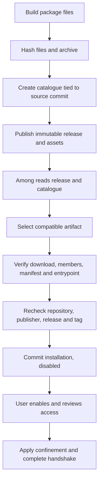

# Packaging and releases

Among 0.2.0 installs ready-built plugin packages from a catalogue. It does not
compile them or run installation hooks. For end-user installation, see the
[Among website](https://among-terminal.github.io/plugins/). For local testing,
see [development mode](guide.md#development-mode).

## Package layout

Package paths start at the archive root. For the unchanged template, use:

```text
among-plugin.json
bin/
    hello-status
LICENSE
```

The manifest and its declared executable entrypoint are required by Among.
Include the licensing and attribution files that apply to your plugin too.
Every regular file, including those files, must appear in the catalogue's
`members` array.

The packaged `among-plugin.json` must be non-executable. Its field rules are in
the [manifest reference](api.md#manifest). The entrypoint must be executable and
nonempty. Use ordinary file permissions such as `0644` for metadata and `0755`
for executables and directories. Archive mode bits outside `0755` are refused,
including group write, world write and special permission bits.

Paths must satisfy the [relative-path rules](api.md#manifest). No path component
may start with `.among-`; these names are reserved for Among's own installation
records. Symlinks, hard links, special files, extended tar headers, duplicate
paths and undeclared files are refused. Directory entries may only describe
parents of declared files. Do not wrap the package in an extra top-level
directory.

## Runtime requirements

Among launches the entrypoint directly and supplies no language runtime. A
native package must contain a matching Linux ELF64 executable. The inspector
checks the architecture and executable structure, including its interpreter
when one is declared.

For a script package, the first line must be exactly `#!/usr/bin/<name>` and LF,
using the interpreter declared in the catalogue. Shebang arguments, spaces,
CRLF and `/usr/bin/env` wrappers are refused. Interpreter and dependency checks
inspect installed files without executing version probes.

## Catalogue

Publish `among-plugins.json` as a release asset. Among reads it from the selected
release, not from the repository's default branch. The catalogue uses schema 2.
All fields below are required unless marked optional. Unknown fields and
duplicate JSON keys are rejected.

| Object | Fields |
| --- | --- |
| Catalogue | `schema_version: 2`, `plugins`: nonempty array of plugin entries. |
| Plugin entry | `id`: local plugin ID; `versions`: array containing exactly one version. |
| Version | `revision`: 40-character lowercase Git commit SHA; `manifest_sha256`: SHA-256 of packaged manifest bytes; `manifest`: schema-1 manifest object; `artifacts`: nonempty array. |
| Artifact | `os: "linux"`; `architecture: "amd64"` or `"arm64"`; `runtime`; `dependencies`; `format: "tar.gz"`; `asset`: exact filename; `size`: compressed bytes; `sha256`: compressed-file hash; `members`: regular-file list. |
| Native runtime | `kind: "native"`; `libc: "glibc"` or `"musl"`; `minimum`: numeric libc version string. |
| Script runtime | `kind: "script"`; `executable`: installed `/usr/bin/<name>`; optional `minimum`: numeric version string or null. |
| Dependency | `executable`: installed `/usr/bin/<name>`; optional `minimum`: numeric version string or null. |
| Member | `path`: package-relative path; `size`: bytes; `sha256`: file hash; `executable`: boolean. |

For one plugin, the root may instead contain `schema_version: 2` and the version
fields directly. In the multi-plugin form, each manifest's `id` must match its
plugin entry. `dependencies` may be empty. A non-null script or dependency
`minimum` makes the artifact unavailable because Among cannot verify it without
a version probe.

Dependency executable paths must be unique.

Exactly one artifact must match the host. Native selection measures glibc; it
does not assume a musl version. Choose the runtime requirements from the actual
build and test environment, not from the archive's filename.

Hashes contain 64 lowercase hexadecimal characters. `manifest_sha256` hashes
the exact packaged file, including whitespace and its final newline. The
embedded `manifest` object must agree with that file. List each regular file's
exact size, hash and executable flag. Reformatting a manifest after calculating
its hash invalidates the package metadata.

| Limit | Maximum |
| --- | --- |
| Catalogue bytes | 1 MiB |
| Plugins per catalogue | 32 |
| Artifacts per version | 8 |
| External dependencies per artifact | 16 |
| Compressed package | 64 MiB |
| Expanded package | 256 MiB |
| Regular files per package | 2,048 |
| Individual file | 64 MiB |

The [manifest byte limit](api.md#manifest) also applies to its member entry.

## Prepare a local package

Build the template using the [quick start](../README.md#create-and-build).
Stage the files under an unused directory, preserving the layout above. For
the unchanged template and the default Cargo output directory:

```sh
install -D -m 0755 target/release/hello-status target/plugin-package/bin/hello-status
install -m 0644 plugins/hello-status/among-plugin.json target/plugin-package/among-plugin.json
install -m 0644 LICENSE target/plugin-package/LICENSE
mkdir -p target/plugin-catalogue
tar --format=ustar -czf target/plugin-catalogue/hello-status.tar.gz -C target/plugin-package among-plugin.json bin LICENSE
```

Write `target/plugin-catalogue/among-plugins.json` using the
[catalogue fields](#catalogue). Use the manifest's actual values, a source commit
from `git rev-parse HEAD`, the build's architecture and runtime requirements,
and measurements of the staged files and compressed archive. Include
`among-plugin.json`, `bin/hello-status` and `LICENSE` in `members`. For example,
these commands measure the manifest without changing it:

```sh
stat -c %s target/plugin-package/among-plugin.json
sha256sum target/plugin-package/among-plugin.json
jq -e . target/plugin-catalogue/among-plugins.json
```

Repeat the size and hash measurements for every member and the archive. JSON
syntax validation with `jq` does not check the catalogue contract or hashes;
Among performs those checks when reviewing and installing the package.
The template has no local catalogue-generation command. Do not substitute
example hashes, an arbitrary libc minimum or an unlisted file.

Keep the catalogue beside its named package files, then use
[development mode](guide.md#development-mode). Rebuild the catalogue metadata
whenever package bytes change.

## Repository releases and install verification

Stable discovery uses the public GitHub repository's latest release. It must
be non-draft, non-prerelease and immutable. Enable immutable releases in the
repository settings before publishing.

Among obtains numeric repository, publisher, release and asset identities from
GitHub. Do not put `release_id` or `asset_id` in the catalogue. The release
inventory may contain at most 64 assets, all uploaded, each with a valid size
and SHA-256 digest. This includes assets not selected for the host. There must
be exactly one `among-plugins.json`.

The selected release tag must resolve to every listed version's `revision`.
Every declared artifact must be present in that same release with the declared
size and hash, including artifacts for other architectures and plugins. A
version-level `release` field is rejected as unknown. Among 0.2.0 cannot use it
to fetch an unchanged plugin's package from an earlier release.

Among selects a compatible artifact. Archive inspection verifies member paths,
types, sizes, hashes and executable flags, then the manifest and entrypoint.
It does not execute the plugin during inspection.

Before committing the installation, Among rechecks repository identity,
publisher, release inventory and tag resolution. A change requires a new
refresh and review. A new installation remains disabled. Runtime access review,
confinement and admission happen separately.



Matching hashes and commits establish content consistency. They do not prove a
reproducible build or independently authenticate the publisher.

## Versions

Each plugin has its own version in `plugins/<id>/among-plugin.json`. Raise it
when its packaged content or source revision changes, including changes to the
executable, manifest, attribution or dependency files. Use
semantic versioning: patch for a fix, minor for an added capability and major
for a breaking change such as removed settings.

Among orders updates only for complete Semantic Versioning strings such as
`1.2.0` or `1.2.0-rc.1`. Values such as `1.2` or `v1.2.0` pass manifest text
validation but have no update order. Lower versions are refused. The same
version with different manifest bytes, package bytes or source commit is a
publisher inconsistency.

In a repository with several plugins, unchanged package bytes do not exempt a
listed plugin from the [selected-release rules](#repository-releases-and-install-verification).
If the new tag resolves to a different commit, each listed plugin needs a new
version to remain eligible for updates from its previous installation.

The Cargo package version is not the version Among reads. You can keep it equal
to the manifest version for consistent build output. Protocol and settings
versions have separate meanings; see [version negotiation](api.md#version-negotiation).

A release is a repository snapshot containing one version of each listed
plugin. Its tag labels that snapshot and need not equal every plugin's version.
This template's release trigger accepts `v*` tags and excludes `v*-*`. A tag
such as `hello-status/v1.2.3` does not match that trigger.

## Making a release

The template's [Check](../.github/workflows/check.yml) and
[Release](../.github/workflows/release.yml) workflows call
`Among-Terminal/among-plugins/.github/workflows/plugin-release.yml` at the same
pinned commit. Allow the reusable workflow in your repository's Actions
settings. For its build, packaging and publishing procedure, follow the
[workflow author instructions](https://github.com/Among-Terminal/among-plugins/blob/main/docs/author-release.md).

1. Compare packaged content with the previous release. Open a release pull
   request titled `chore(release): v<label>` that raises manifest versions as
   required by the [version rules](#versions). Keep implementation changes in
   earlier pull requests.
2. Wait for the checks, then squash-merge the release pull request.
3. Create a stable tag on its merge commit and push it. For example:

```sh
git tag v0.1.0
git push origin v0.1.0
```

The tag starts the release workflow. This template contains no workflow that
creates tags after merging pull requests. Its check call uses `publish: false`;
the release call does not override the reusable workflow's inputs.

Keep source, catalogue and package bytes consistent. If a published immutable
release is wrong, publish a new version. Do not edit its assets.

## Release candidates

A candidate uses a tag such as `v1.0.0-rc.1`. This template's stable tag trigger
excludes tags with a hyphen, so pushing that tag starts no release workflow.
Candidate publishing requires a separate invocation configured for a
prerelease. Follow the reusable workflow's
[approved-preparation instructions](https://github.com/Among-Terminal/among-plugins/blob/main/docs/author-release.md#publishing-approved-preparation-bytes)
before adding such a workflow; the template does not include one.

The reusable workflow refuses a stable tag that has release candidates unless
the call passes `candidate-tag` naming one of them, and it then publishes the
candidate's bytes. This template's release call passes no inputs. After
publishing `v1.0.0-rc.1`, pushing `v1.0.0` therefore fails until the caller is
extended to pass `candidate-tag`.

Use [development mode](guide.md#development-mode) to test prereleases. A later
compatible stable release can update a prerelease installation. The same plugin
version can become stable only when its bytes and source commit match. If code
changes after a candidate, raise the affected plugin version.

## Pull requests

The [PR title check](../.github/workflows/pr-title.yml) accepts `feat`, `fix`,
`docs`, `test`, `ci`, `build`, `perf`, `refactor` or `chore`, an optional
`(scope)`, and `!` before the colon for a breaking change. Use squash merging
to retain that title as the commit subject.

## Implementation sources

- [Catalogue parsing and artifact selection](https://github.com/Among-Terminal/among/blob/v0.2.0/src/plugin/install/metadata.rs).
- [Archive verification](https://github.com/Among-Terminal/among/blob/v0.2.0/src/plugin/install/package.rs)
  and [entrypoint inspection](https://github.com/Among-Terminal/among/blob/v0.2.0/src/plugin/install/entrypoint.rs).
- [Repository verification](https://github.com/Among-Terminal/among/blob/v0.2.0/src/plugin/install/source.rs)
  and [local installation](https://github.com/Among-Terminal/among/blob/v0.2.0/src/plugin/install/local.rs).
